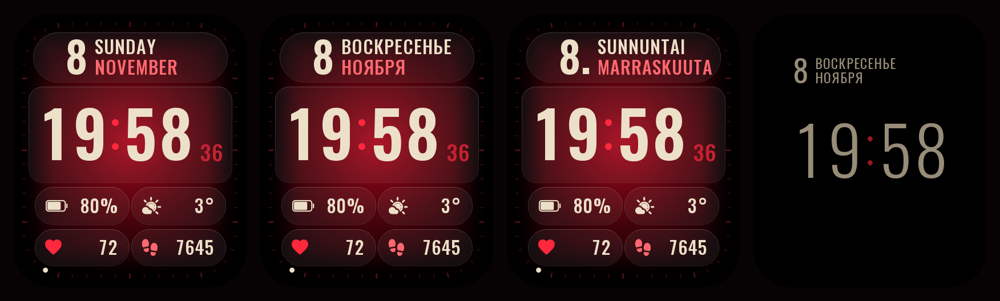
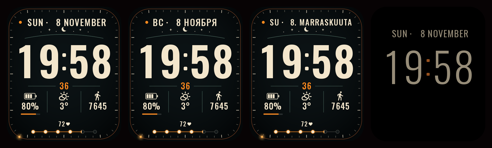

# hwt-machine

Watch faces from code. Fonts and a short layout script go in; an installable `.hwt`
watch face comes out, drawn, packed and checked without a single hand-painted pixel.

**[Live page](https://shumtugle.github.io/hwt-machine/)**: Vibe running in the browser on
your clock, and a drop zone that opens any watch face package and draws it.



## Vibe

The first face built with the machine. Black and scarlet, glass cards, the weekday and
the month in words, 24-hour time with seconds, battery, weather, pulse and steps, and a
cream mark that runs around the frame once a minute. Tapping a tile opens the matching
screen on the watch.

Download it in
[English](https://github.com/Shumtugle/hwt-machine/raw/main/docs/faces/vibe-en.hwt),
[Russian](https://github.com/Shumtugle/hwt-machine/raw/main/docs/faces/vibe-ru.hwt) or
[Finnish](https://github.com/Shumtugle/hwt-machine/raw/main/docs/faces/vibe-fi.hwt),
or [all three in one](https://github.com/Shumtugle/hwt-machine/raw/main/docs/faces/vibe.hwt)
(switch in the face editor: *Date* is Russian, *Day of week* English, *Sun* Finnish)
(also attached to [Releases](https://github.com/Shumtugle/hwt-machine/releases)) and
install it with any app that can send a watch face file to the watch.

`--dial` builds the same face with the dial of the glass phone widget it grew from in the
date card: a fine ring, bars at the quarters, dots between, two bar hands
([`vibe-dial-ru.hwt`](https://github.com/Shumtugle/hwt-machine/raw/main/docs/faces/vibe-dial-ru.hwt) and the
other languages next to it).

Built for 408 × 480 screens (screen code `HWHD13`). Runs on the HUAWEI WATCH FIT 4;
faces for this screen are reported to work on the FIT 3 as well, memory permitting.

## Night Tram

Ink background, cream numerals, amber lights: a little of an old instrument, a little of
an evening city. A lamp runs along the copper frame with the seconds, a thin horizon with
a few stars hangs over the time, and the small lamp before the date lights up while
messages wait unread. Battery, weather and steps share one row; the pulse sits below.



Download it in
[English](https://github.com/Shumtugle/hwt-machine/raw/main/docs/faces/night-tram-en.hwt),
[Russian](https://github.com/Shumtugle/hwt-machine/raw/main/docs/faces/night-tram-ru.hwt) or
[Finnish](https://github.com/Shumtugle/hwt-machine/raw/main/docs/faces/night-tram-fi.hwt),
or [all three in one](https://github.com/Shumtugle/hwt-machine/raw/main/docs/faces/night-tram.hwt).
The message lamp uses a source seen in other faces, not yet confirmed with this one.

## Plumb

Black, and two lines of type: the hour above the minute. A red weight slides down a
cream thread once a minute, in six lengths of ten seconds. The date hangs from the same
left margin at the top, the weather at the foot. No cards, no rings, no goals, no
charge: the watch says so itself when it runs low.

[RU](https://github.com/Shumtugle/hwt-machine/raw/main/docs/faces/plumb-ru.hwt) ·
[EN](https://github.com/Shumtugle/hwt-machine/raw/main/docs/faces/plumb-en.hwt) ·
[FI](https://github.com/Shumtugle/hwt-machine/raw/main/docs/faces/plumb-fi.hwt) ·
[all three](https://github.com/Shumtugle/hwt-machine/raw/main/docs/faces/plumb.hwt)

## Lighthouse

A painted night sea with a lighthouse on a cliff. The time in a warm serif across the
stars, the seconds quiet beneath it, the date above; a golden wave with a small boat on
its crest, and battery, weather, pulse and steps on the dark water below it.
`--art night` swaps the calm painting for a richer one, with the wave drawn over it.

[RU](https://github.com/Shumtugle/hwt-machine/raw/main/docs/faces/lighthouse-ru.hwt) ·
[EN](https://github.com/Shumtugle/hwt-machine/raw/main/docs/faces/lighthouse-en.hwt) ·
[FI](https://github.com/Shumtugle/hwt-machine/raw/main/docs/faces/lighthouse-fi.hwt) ·
[all three](https://github.com/Shumtugle/hwt-machine/raw/main/docs/faces/lighthouse.hwt)

## Faces from a description

A face can also be written as data instead of code: a JSON description of the
background, the elements, their sources, styles and positions. The machine draws,
packs and checks it, and every problem comes back as one line saying where it is and
what to change, so a person or a language model can correct the description without
reading any code.

```sh
python3 tools/build.py faces/plumb/face.json --check
python3 tools/build.py faces/plumb/face.json --langs ru,en,fi
```

Vibe and Plumb are described this way in `faces/vibe/face.json` and
`faces/plumb/face.json`, and build into exactly the pixels of their hand-written
scripts. [docs/AUTHORING.md](docs/AUTHORING.md) is the full vocabulary.

## What the machine does

- **Writes the container byte-exact.** Header, protobuf layout, image table and
  run-length images; existing faces round-trip through it byte for byte.
- **Places glyphs by their ink.** Digits, capitals and symbols line up on their visible
  pixels, not on font metrics. A colon sits on the true middle of the digits.
- **Fits words to their card.** Weekdays and months come from a locale file; long words
  shrink until they fit.
- **Moves a mark around the frame.** The watch only offers the tens and the units of the
  second. Six strips and one covering layer still show a single mark stepping through all
  sixty positions.
- **Checks itself.** Previews are drawn by a simulator that reads the finished package,
  so a broken file shows up before it reaches a wrist. A card that would touch the frame
  stops the build.
- **Reads other faces.** `tools/inspect.py` prints any package's layout with named data
  sources, extracts its images and renders it.

## Build

Python 3 and Pillow.

```sh
python3 faces/vibe/build.py all          # every locale into dist/
python3 faces/night-tram/build.py all
python3 faces/vibe/build.py ru           # one locale
python3 tools/inspect.py dist/vibe-ru.hwt --images out/ --render screen.png
python3 tools/build.py faces/vibe/face.json  # the same face from its description
python3 -m unittest discover tests
cp dist/*.hwt docs/faces/                # refresh the faces on the live page
```

A new language is one JSON file in `faces/vibe/locale/` with seven weekdays, twelve
months and an optional suffix after the day number.

`--switchable ru,en,fi` also builds one face carrying all three languages, switched in
the watch's face editor. It works; the editor names the three choices after the
functions it borrows them from (*Date*, *Day of week*, *Sun*), not after the languages.

## Layout of the repository

| path | content |
|---|---|
| `machine/container.py` | package, binary, image and protobuf reading and writing |
| `machine/layout.py` | image registry, element builders, groups and zones |
| `machine/codes.py` | element kinds, data sources, tap targets, with what is verified |
| `machine/draw.py` | text styles, symbols, glass cards, glow, the tick ring |
| `machine/effects.py` | the running mark |
| `machine/simulate.py` | draws a package the way the watch would |
| `machine/spec.py` | builds a face from a description, and explains what is wrong with one |
| `machine/locales/` | weekday and month names for the descriptions |
| `faces/vibe/` | the Vibe face and its locales |
| `faces/night-tram/` | the Night Tram face and its locales |
| `faces/plumb/` | the Plumb face and its locales |
| `faces/lighthouse/` | the Lighthouse face, its painting and its locales |
| `tools/inspect.py` | look inside any face |
| `tools/build.py` | build a face from a description |
| `docs/` | the live page, its renderer, the [format notes](docs/FORMAT.md) and the [authoring guide](docs/AUTHORING.md) |

## Format

Everything known about the format, verified or only observed, is in
[docs/FORMAT.md](docs/FORMAT.md).

## Licence

Code: MIT, see [LICENSE](LICENSE).
The text faces are under the SIL Open Font License 1.1
([Oswald](fonts/OFL-Oswald.txt), [Cormorant](fonts/OFL-Cormorant.txt)).
The symbol font is a subset of an icon font under the Apache License 2.0
([fonts/LICENSE-symbols.txt](fonts/LICENSE-symbols.txt)), reduced to the glyphs the faces use.
