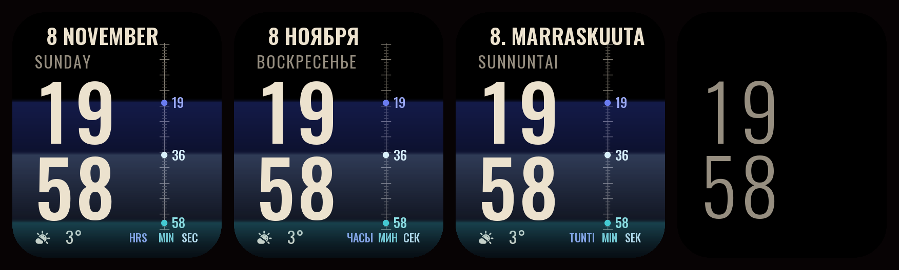
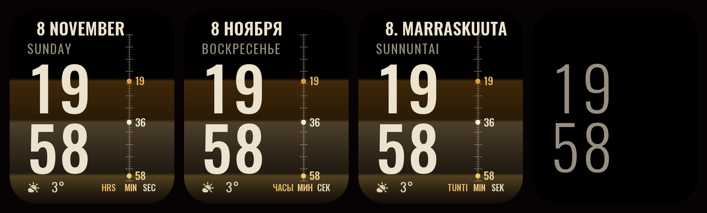
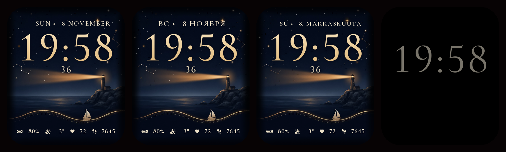
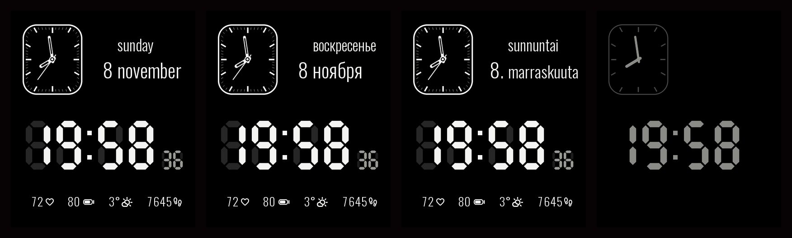
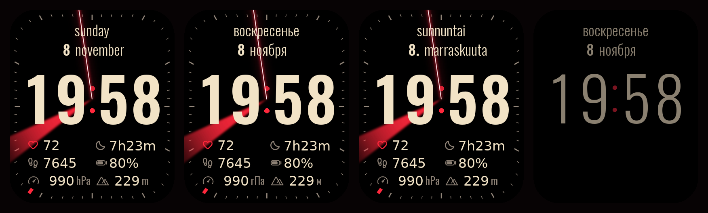
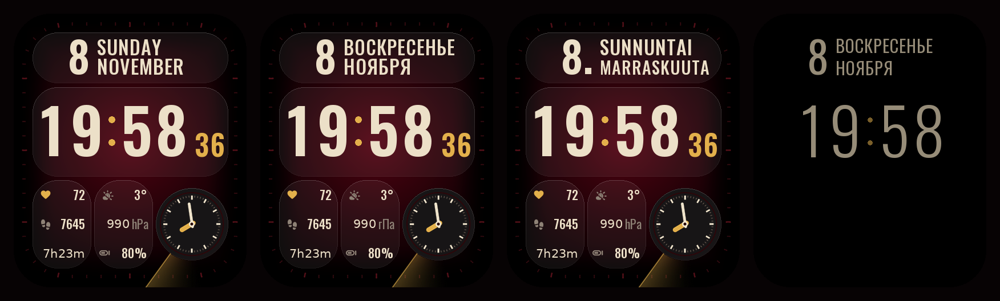
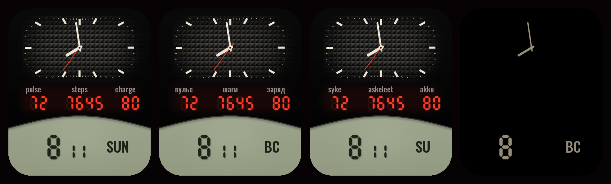
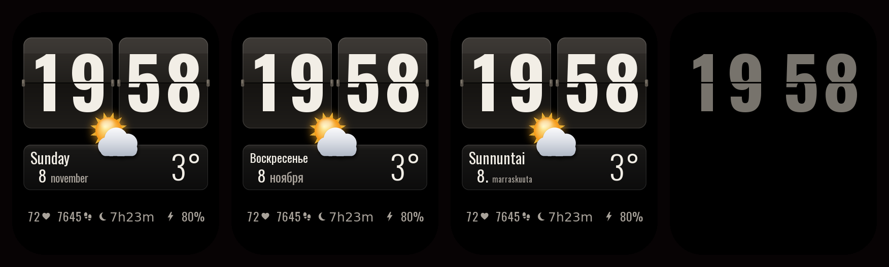

# hwt-machine

Watch faces from code. Fonts and a short layout script go in; an installable `.hwt`
watch face comes out, drawn, packed and checked without a single hand-painted pixel.

**[Live page](https://shumtugle.github.io/hwt-machine/)**: Vibe running in the browser on
your clock, and a drop zone that opens any watch face package and draws it.

**[Telegram channel](https://t.me/HW_watch_faces)**: new faces as they come out, each with its files.


## Vibe

The first face built with the machine. Black and scarlet, glass cards, the weekday and
the month in words, 24-hour time with seconds, battery, weather, pulse and steps, and a
cream mark that runs around the frame once a minute. Tapping a tile opens the matching
screen on the watch.

Download it in
[English](https://github.com/Shumtugle/hwt-machine/raw/main/docs/faces/vibe-en.hwt),
[Russian](https://github.com/Shumtugle/hwt-machine/raw/main/docs/faces/vibe-ru.hwt) or
[Finnish](https://github.com/Shumtugle/hwt-machine/raw/main/docs/faces/vibe-fi.hwt)
and install it with any app that can send a watch face file to the watch. Every face
comes as one file per language, and each file is in its language on both screens: the
live page has [an English](https://shumtugle.github.io/hwt-machine/),
[a Russian](https://shumtugle.github.io/hwt-machine/ru/) and
[a Finnish](https://shumtugle.github.io/hwt-machine/fi/) edition.

Built for 408 × 480 screens (screen code `HWHD13`). Runs on the HUAWEI WATCH FIT 4;
faces for this screen are reported to work on the FIT 3 as well, memory permitting.

## Night Tram

Ink background, cream numerals, amber lights: a little of an old instrument, a little of
an evening city. A lamp runs along the copper frame with the seconds, a thin horizon with
a few stars hangs over the time, and the small lamp before the date lights up while
messages wait unread. Battery, weather and steps share one row; the pulse sits below.


Download it in
[English](https://github.com/Shumtugle/hwt-machine/raw/main/docs/faces/night-tram-en.hwt),
[Russian](https://github.com/Shumtugle/hwt-machine/raw/main/docs/faces/night-tram-ru.hwt) or
[Finnish](https://github.com/Shumtugle/hwt-machine/raw/main/docs/faces/night-tram-fi.hwt).
The message lamp uses a source seen in other faces, not yet confirmed with this one.

## Plumb

Black, the date and the weekday above, the hour over the minute in tall type, and a
plumb scale on the right. The hour, the minute and the second hang on it as levels, a
dot and a number each, and every level pours a sheet of light from its height down to
the bottom of the screen, fading as it goes. The sheets overlap into strata: the second
breathes, the minute steps, the hour barely moves all day. Two colourings: ice
(indigo, teal, ice) and amber (amber, gold, cream).



[RU](https://github.com/Shumtugle/hwt-machine/raw/main/docs/faces/plumb-ru.hwt) ·
[EN](https://github.com/Shumtugle/hwt-machine/raw/main/docs/faces/plumb-en.hwt) ·
[FI](https://github.com/Shumtugle/hwt-machine/raw/main/docs/faces/plumb-fi.hwt)



[RU](https://github.com/Shumtugle/hwt-machine/raw/main/docs/faces/plumb-amber-ru.hwt) ·
[EN](https://github.com/Shumtugle/hwt-machine/raw/main/docs/faces/plumb-amber-en.hwt) ·
[FI](https://github.com/Shumtugle/hwt-machine/raw/main/docs/faces/plumb-amber-fi.hwt)

## Lighthouse

A painted night sea with a lighthouse on a cliff. The time in a warm serif across the
stars, the seconds in warm cream beneath it, the date above; a golden wave with a small
boat on its crest, and battery, weather, pulse and steps on the dark water below it.
`--art night` swaps the calm painting for a richer one, with the wave drawn over it.



[RU](https://github.com/Shumtugle/hwt-machine/raw/main/docs/faces/lighthouse-ru.hwt) ·
[EN](https://github.com/Shumtugle/hwt-machine/raw/main/docs/faces/lighthouse-en.hwt) ·
[FI](https://github.com/Shumtugle/hwt-machine/raw/main/docs/faces/lighthouse-fi.hwt)

## Duo

Hands and crystal digits together. The dial is a small copy of the screen itself,
rounded the same way; beside it the weekday and the month in full words, the day number
hanging to their left. The time below in segments over their unlit ghosts, and four
readings along the foot: pulse, charge, weather, steps.



[RU](https://github.com/Shumtugle/hwt-machine/raw/main/docs/faces/duo-ru.hwt) ·
[EN](https://github.com/Shumtugle/hwt-machine/raw/main/docs/faces/duo-en.hwt) ·
[FI](https://github.com/Shumtugle/hwt-machine/raw/main/docs/faces/duo-fi.hwt)

## Strobe

Black, and a time so large it fills the width. The hour is a scarlet searchlight and the
minute a laser, both turning from the colon under everything that is read. Above, the
weekday and the date in quiet lower case; below, six readings in the watch's own type:
pulse, sleep, steps, charge, air pressure and altitude. A scarlet mark runs once a minute
along a band of sixty ticks that follows the visible edge of the glass, corners included.



[RU](https://github.com/Shumtugle/hwt-machine/raw/main/docs/faces/strobe-ru.hwt) ·
[EN](https://github.com/Shumtugle/hwt-machine/raw/main/docs/faces/strobe-en.hwt) ·
[FI](https://github.com/Shumtugle/hwt-machine/raw/main/docs/faces/strobe-fi.hwt)

## Rubis

Garnet and gold, like the jewels of a movement. The weekday and the month in words
above, the time with gold seconds in the middle; below, two stacks of three readings
(pulse, steps and sleep; weather, air pressure and charge) beside a small dial with
short hands. A gold sweep turns once a minute from the rim of that dial out to the
edge of the screen, under everything that is read. Every card follows one rule:
radius 44, 33 px in from the edges.



[RU](https://github.com/Shumtugle/hwt-machine/raw/main/docs/faces/rubis-ru.hwt) ·
[EN](https://github.com/Shumtugle/hwt-machine/raw/main/docs/faces/rubis-en.hwt) ·
[FI](https://github.com/Shumtugle/hwt-machine/raw/main/docs/faces/rubis-fi.hwt)

## Triptych

Three windows in a black case, three ages of the watch. Above, hands over a dial of
deep pyramids that runs on under the bezel and ends in an arch turned down, with applied
indices and a ruby lamp below the hands that lights while messages wait. In the middle,
pulse, steps and charge in red lamps set in sunken windows. Below, a crystal display
under a rising arch: the day and the month in dark segments, the weekday, and the
weather beneath it. Ten glass lamps ride the crystal's lip and light one a second; after
them stand the tens of seconds already passed.



[RU](https://github.com/Shumtugle/hwt-machine/raw/main/docs/faces/triptych-ru.hwt) ·
[EN](https://github.com/Shumtugle/hwt-machine/raw/main/docs/faces/triptych-en.hwt) ·
[FI](https://github.com/Shumtugle/hwt-machine/raw/main/docs/faces/triptych-fi.hwt)

## Flip

Two dark flip cards for the hours and the minutes, after a phone clock many loved: each
split at its middle with a hinge at each side, the lower half a shade deeper than the
upper, the split running through the figures as it would on real cards. The weather is a
glossy picture of its own, a sun, clouds, rain, snow, a storm or a moon, set in the
middle over the foot of the cards. Under them a bar with the weekday, the day and the
month in full words and the temperature, and a quiet line of heart, steps, the night's
sleep and the charge. The same face lives among the clocks of a home screen.



[RU](https://github.com/Shumtugle/hwt-machine/raw/main/docs/faces/flip-ru.hwt) ·
[EN](https://github.com/Shumtugle/hwt-machine/raw/main/docs/faces/flip-en.hwt) ·
[FI](https://github.com/Shumtugle/hwt-machine/raw/main/docs/faces/flip-fi.hwt)

## Faces from a description

A face can also be written as data instead of code: a JSON description of the
background, the elements, their sources, styles and positions. The machine draws,
packs and checks it, and every problem comes back as one line saying where it is and
what to change, so a person or a language model can correct the description without
reading any code. Before packing, the machine looks at what it drew: colliding
elements, anything under the second mark's path, text lost against its background,
ink in the rounded corners.

```sh
python3 tools/build.py faces/duo/face.json --check
python3 tools/build.py faces/duo/face.json --langs ru,en,fi
```

Most faces here are described this way, each in `faces/<name>/face.json`. Vibe was
first written as a script and its description built into exactly the same pixels,
until its ring moved onto the visible line of the glass. [docs/AUTHORING.md](docs/AUTHORING.md) is the full vocabulary.

## What the machine does

- **Writes the container byte-exact.** Header, protobuf layout, image table and
  run-length images; existing faces round-trip through it byte for byte.
- **Places glyphs by their ink.** Digits, capitals and symbols line up on their visible
  pixels, not on font metrics. A colon sits on the true middle of the digits.
- **Fits words to their card.** Weekdays and months come from a locale file; long words
  shrink until they fit.
- **Moves a mark around the frame.** The watch only offers the tens and the units of the
  second. Six strips and one covering layer still show a single mark stepping through all
  sixty positions.
- **Checks itself.** Previews are drawn by a simulator that reads the finished package,
  so a broken file shows up before it reaches a wrist. A card that would touch the frame
  stops the build.
- **Reads other faces.** `tools/inspect.py` prints any package's layout with named data
  sources, extracts its images and renders it.

## Build

Python 3 and Pillow.

```sh
python3 faces/vibe/build.py all          # every locale into dist/
python3 faces/night-tram/build.py all
python3 faces/vibe/build.py ru           # one locale
python3 tools/inspect.py dist/vibe-ru.hwt --images out/ --render screen.png
python3 tools/build.py faces/vibe/face.json  # the same face from its description
python3 -m unittest discover tests
cp dist/*.hwt docs/faces/                # refresh the faces on the live page
python3 tools/pages.py                   # rewrite its English, Russian and Finnish editions
```

A new language is one JSON file in `faces/vibe/locale/` with seven weekdays, twelve
months and an optional suffix after the day number.

`--switchable ru,en,fi` (and `--together` for faces built from a description) also
builds one face carrying all three languages, switched in the watch's face editor. Only
the normal screen switches: the always-on screen stays in the first language, so the
faces are published one file per language. The editor names the three choices after
the functions it borrows them from (*Date*, *Day of week*, *Sun*), not after the
languages.

## Layout of the repository

| path | content |
|---|---|
| `machine/container.py` | package, binary, image and protobuf reading and writing |
| `machine/layout.py` | image registry, element builders, groups and zones |
| `machine/codes.py` | element kinds, data sources, tap targets, with what is verified |
| `machine/draw.py` | text styles, symbols, glass cards, glow, the tick ring |
| `machine/effects.py` | the running mark |
| `machine/simulate.py` | draws a package the way the watch would |
| `machine/spec.py` | builds a face from a description, and explains what is wrong with one |
| `machine/locales/` | weekday and month names for the descriptions |
| `faces/vibe/` | the Vibe face and its locales |
| `faces/night-tram/` | the Night Tram face and its locales |
| `faces/plumb/` | Plumb, in ice (`face.json`) and in amber (`amber.json`) |
| `faces/lighthouse/` | the Lighthouse face, its painting and its locales |
| `faces/duo/` | the Duo face |
| `faces/strobe/` | the Strobe face, being tried on the wrist |
| `tools/inspect.py` | look inside any face |
| `tools/build.py` | build a face from a description |
| `tools/pages.py` | write the live page's three editions from `tools/page/` |
| `docs/` | the live page, its renderer, the [format notes](docs/FORMAT.md) and the [authoring guide](docs/AUTHORING.md) |

## Format

Everything known about the format, verified or only observed, is in
[docs/FORMAT.md](docs/FORMAT.md).

## Licence

Code: MIT, see [LICENSE](LICENSE).
The text faces are under the SIL Open Font License 1.1
([Oswald](fonts/OFL-Oswald.txt), [Cormorant](fonts/OFL-Cormorant.txt)).
The symbol font is a subset of an icon font under the Apache License 2.0
([fonts/LICENSE-symbols.txt](fonts/LICENSE-symbols.txt)), reduced to the glyphs the faces use.
